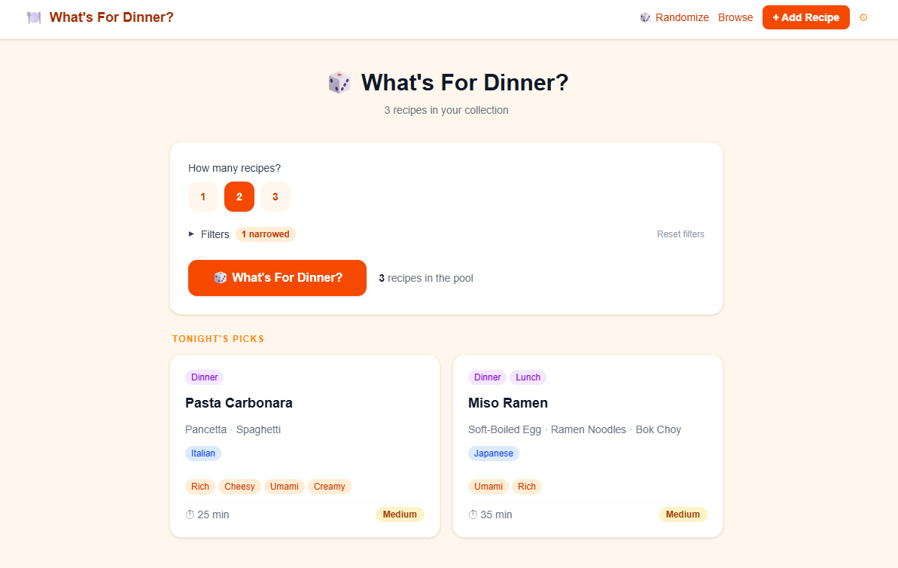

# 🍽️ What's For Dinner?

A personal recipe database and randomizer, built for exactly one household argument: *"I don't know, what do you want?"*

Add the recipes you've cooked (or want to try), tag them however makes sense to you, and let the app pick — with a little flair — so "what's for dinner" stops being a nightly negotiation.

[](docs/screenshot-randomizer.png)

## What it does

- **Kitchens & accounts** — sign in with an emailed magic link (no passwords). Every account gets its own **Kitchen**: a private recipe collection that can grow into a shared household. Invite people and give each one a role: *Restaurateur* (full control), *Chef* (add, edit, and delete recipes), or *Diner* (read-only, but can still rate, add notes, and log cooks).
- **The Cookbook** — store recipes with core components (protein, starch, vegetable), structured ingredient lists, and directions, tagged by meal type, cuisine, flavor notes, season, difficulty, and cooking method. Search and filter to find what you're after.
- **Recipe import** — pull a recipe in from a URL, or snap one or more photos and let Claude read it for you. Ingredient lines are parsed with plain rules first, with Claude only stepping in for the ambiguous ones.
- **The randomizer** — pick one recipe at random, or up to three at once, using the same filters as the Cookbook. Comes with a proper slot-machine-style reveal, because a plain instant answer felt like it deserved more ceremony.
- **Cook history & ratings** — mark a recipe as cooked, see when you last made it, and give it a quick thumbs up or down so the randomizer can learn what's actually a hit.
- **Global Recipe Pool** — a shared starter library so new kitchens come pre-stocked with recipes in the cookbook. A toggle hides the starter recipes whenever you'd rather see only your own.
- **Sharing** — generate an unlisted link for any recipe (revoke it anytime), and anyone who opens it can pull a copy into their own kitchen. You can also export a good-looking recipe card image with a QR code that points back to the recipe.
- **Backup & restore** — export your whole kitchen to a file, and merge it back in later without ever risking a duplicate or an accidental wipe.

### On the roadmap

Not built yet, but planned: a "full week" meal-planning mode, a shopping list, and dinner party mode (with sides, appetizers, and drinks). See [`docs/ROADMAP.md`](docs/ROADMAP.md) for the full picture.

## Tech stack

- [Next.js](https://nextjs.org/) 16 (App Router, TypeScript) and React 19
- [Tailwind CSS](https://tailwindcss.com/) 4
- [Prisma](https://www.prisma.io/) 7 ORM with [PostgreSQL](https://www.postgresql.org/) <!-- CONFIRM: production database provider (README previously said Vercel Postgres) -->
- [Auth.js](https://authjs.dev/) (NextAuth v5) with email magic links sent through [Resend](https://resend.com/)
- [Anthropic API](https://docs.anthropic.com/) (Claude Haiku) for photo import and ingredient-parsing fallback
- Deployed on [Vercel](https://vercel.com/)

## Getting started

### Prerequisites

- Node.js 20.19 or later (Prisma 7's minimum; 22.12+ and 24+ also work)
- A PostgreSQL database — a local instance, or a free hosted one such as [Neon](https://neon.tech/)
- A [Resend](https://resend.com/) account for sign-in emails. Until you verify a domain there, Resend's test sender can only deliver to the address on your own Resend account, which is fine for solo local development.
- *Optional:* an [Anthropic API key](https://console.anthropic.com/) to enable photo import and smarter ingredient parsing

### Setup

1. Clone the repo and install dependencies:

   ```bash
   git clone https://github.com/michaelhobson/whats-for-dinner.git
   cd whats-for-dinner
   npm install
   ```

2. Copy the example environment file and fill in your own values:

   ```bash
   cp .env.example .env
   ```

   See [Environment variables](#environment-variables) below for what each one does. Point `DATABASE_URL` at your **local** database.

3. Apply the database schema and generate the Prisma client:

   ```bash
   npx prisma migrate dev
   npx prisma generate
   ```

   <!-- CONFIRM: is `npx prisma generate` needed here? Prisma 7 no longer runs it after migrate dev, and `npm run dev` doesn't run it. -->

4. *Optional:* seed a few sample recipes:

   ```bash
   npx tsx prisma/seed.ts
   ```

   <!-- CONFIRM: what does seed.ts do now with Kitchens, and how does a fresh database get its Global Pool kitchen? -->

5. Start the dev server:

   ```bash
   npm run dev
   ```

   Open <http://localhost:3000>, enter your email, and click the magic link that arrives. Your first sign-in creates your personal Kitchen.

## Environment variables

Copy `.env.example` to `.env` for local development; on Vercel, set these in the project's environment variables. Never commit real values.

| Variable | Required | Description |
|---|---|---|
| `DATABASE_URL` | Yes | Postgres connection string. Use a local database for development and keep the production URL out of your local `.env`. |
| `AUTH_SECRET` | Yes | Signs session tokens and CSRF tokens. Generate one with `openssl rand -base64 32`. |
| `RESEND_API_KEY` | Yes | Resend API key, used to send magic-link sign-in emails. |
| `RESEND_FROM` | Yes | The "from" address for sign-in emails. Must be on a domain you've verified in Resend. |
| `FOUNDING_KITCHEN_MEMBER_EMAILS` | No | Comma-separated emails that join the founding Kitchen (created by `prisma/migrate-kitchen.ts`) on first sign-in. Only relevant if you're migrating an existing single-household database; everyone else gets their own personal Kitchen. |
| `ANTHROPIC_API_KEY` | No | Enables photo import and Claude-assisted ingredient parsing. If unset, photo import is unavailable and ambiguous ingredient lines are stored as-is. |

## Scripts

| Command | What it does |
|---|---|
| `npm run dev` | Start the local dev server |
| `npm run build` | Generate the Prisma client and build for production |
| `npm start` | Run the production build |
| `npx prisma migrate dev` | Apply schema changes to your **local** database |
| `npx prisma studio` | Open a GUI to browse/edit the database directly |
| `npx tsx prisma/seed.ts` | Seed a few sample recipes. Safe by default (skips if recipes already exist). Passing `--force` **wipes and reseeds** — only ever use it on a local database. |
| `npx tsc --noEmit` | Type-check the project (there's no separate lint or test script) |

## Deployment

This app is built to deploy on Vercel with a hosted Postgres database. In short: push to GitHub, import the repo into Vercel, add the environment variables above in the project settings, and deploy.

The build generates the Prisma client but does **not** run migrations, so apply them to the production database yourself whenever the schema changes:

```bash
npx prisma migrate deploy
```

<!-- CONFIRM: is this how production migrations are applied today? -->

## Project docs

- [`CLAUDE.md`](CLAUDE.md) — conventions and rules for working on the codebase with Claude Code
- [`docs/ARCHITECTURE.md`](docs/ARCHITECTURE.md) — how the Global Pool, sharing, and the recipe card image work
- [`docs/PERMISSIONS.md`](docs/PERMISSIONS.md) — Kitchen roles and permission rules
- [`docs/ROADMAP.md`](docs/ROADMAP.md) — phase status and planned work

## Contributing

This started as a personal project (and a first Claude Code build, at that), not a maintained open-source library — but if you've found your way here and have an idea, feel free to open an issue.

## License

[MIT](LICENSE) — do whatever you'd like with it. If it helps you and your household solve the same nightly argument, that's a win.
